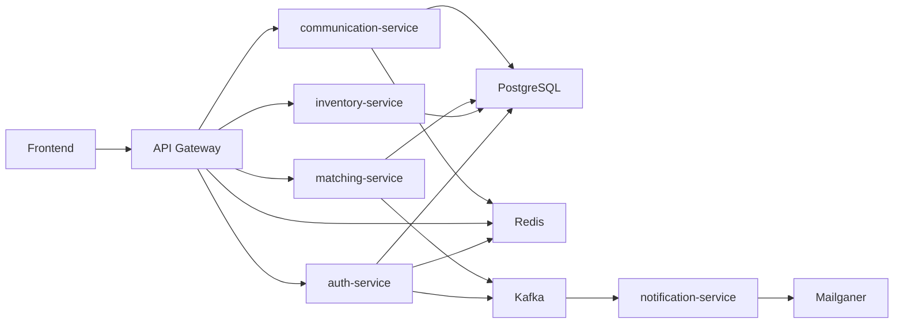

# Архитектура Berusmenu MVP

## Цель

Сделать простой и надежный MVP для срочного подбора работника на смену в ПВЗ, без лишней инфраструктурной сложности.

## High-level topology

## Основные решения

- Frontend ходит только в `api-gateway`.
- Gateway общается с backend services по gRPC.
- Все core business transactions синхронны.
- Kafka используется только для async notification events.
- `notification-service` отделен от доменных сервисов.
- Redis используется для verification/rate limiting/presence.
- Postgres один, но со схемой на сервис.

## Схемы в Postgres

- `auth`
- `inventory`
- `matching`
- `communication`

`notification-service` в MVP без своей схемы и без собственной БД.

## Boundaries

### Auth

- user identity
- account credentials
- JWT issuance and validation
- email verification
- refresh session lifecycle

### Inventory

- PVZ registration
- PVZ moderation
- PVZ updates and repeated moderation

### Matching

- vacancy lifecycle
- response lifecycle
- assignment lifecycle
- reviews
- review replies

### Communication

- conversations
- messages
- message_reads
- websocket-backed realtime chat

### Notification

- Kafka consumer
- event handlers
- email sender
- Mailganer integration

## Sync vs Async

### Синхронно

- register user
- verify email
- create PVZ
- approve/reject PVZ
- create vacancy
- create response
- create conversation
- accept response -> assignment
- cancel/complete assignment
- create review
- create review reply

### Асинхронно

- send verification email
- notify owner about new response

## Data Ownership

- каждый сервис владеет только своей схемой
- cross-schema FK не используются
- идентификаторы из других доменов хранятся как ссылки по id
- валидация междоменной целостности происходит в owning service

## Runtime Roles

### `api-gateway`

- HTTP entrypoint
- auth middleware
- gRPC fan-out
- websocket edge

### `notification-service`

- не имеет публичного API
- работает как background worker
- читает Kafka и отправляет email

## External integrations

- Mailganer для отправки email
- Nginx + SSL на `berusmenu.ru`

## Why this architecture

Плюсы:

- быстрый старт
- понятные границы
- низкая операционная сложность
- легко отдельно развивать notification pipeline later

Минусы:

- меньше изоляции, чем при отдельных БД на сервис
- часть кросс-доменных правил контролируется только кодом

Для MVP это приемлемый trade-off.
