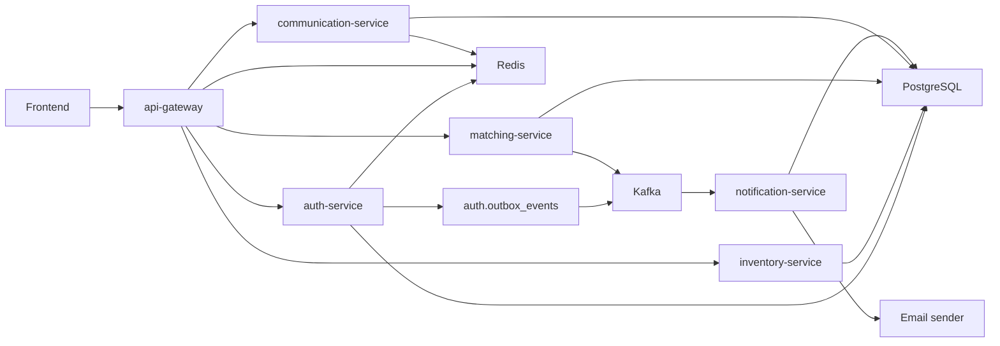

# Architecture Berusmenu MVP

## Goal

Build a simple, production-oriented MVP for urgent PVZ shift staffing. The architecture favors clear ownership, boring infrastructure, and fast delivery over platform complexity.

## High-Level Topology

`matching-service` is implemented as the owner of vacancy, response, assignment, review and rating state. `communication-service` is still planned.

## Decisions

- Frontend talks only to `api-gateway`.
- Browser auth uses HttpOnly cookies.
- Frontend never stores access/refresh tokens in JavaScript.
- First-paint frontend auth bootstrap uses `GET /v1/auth/session`.
- Registration is minimal: `email + password + role`.
- Profile completion happens after email verification and may include optional Telegram and Max usernames.
- Published vacancies can be listed publicly for guest discovery; responses remain authenticated.
- Gateway enforces CSRF for authenticated unsafe methods.
- Gateway forwards identity to backend services through gRPC metadata.
- Backend services talk over gRPC.
- Gateway stays thin; business rules live in owning services.
- Core business transactions are synchronous.
- Kafka is used only for notification events in MVP.
- Notification producers persist events to their own outbox before Kafka publish.
- Redis is used for verification/rate limiting/realtime ephemeral state.
- One Postgres database, separate schema per service.

## Schemas

- `auth`
- `inventory`
- `notification`
- `matching` planned
- `communication` planned

## Boundaries

### Auth

- account identity;
- credentials;
- JWT issuance and validation;
- email verification;
- refresh sessions;
- profile;
- timed user blocks.

### Inventory

- PVZ registration;
- PVZ moderation;
- PVZ updates and repeated moderation;
- moderation history;
- owner spam cleanup for PVZ requests.

### Matching

- vacancy lifecycle;
- response lifecycle;
- assignment lifecycle;
- active vacancy truth;
- reviews and review replies.
- user rating aggregates derived from reviews;
- matching-specific moderator audit events.

### Communication

- conversations;
- messages;
- read state;
- realtime chat semantics.

### Notification

- Kafka consumer;
- event handlers;
- email sender abstraction;
- local log/stub sender.

## Sync vs Async

Synchronous:

- register/login/refresh/logout;
- verify email;
- create/update/moderate PVZ;
- future vacancy/response/assignment/review flows.

Asynchronous:

- send verification email;
- notify owner about new response.

## Data Ownership

- Each service owns only its schema.
- No cross-schema FK.
- Cross-domain ids are stored as plain ids.
- Cross-domain validation happens through owning service RPCs.
- No service writes another service schema.

## Runtime Roles

### `api-gateway`

- HTTP entrypoint;
- auth cookie middleware;
- CSRF/CORS/security headers;
- REST -> gRPC mapping;
- future websocket edge.

### `notification-service`

- no public API;
- background worker;
- consumes Kafka;
- deduplicates processed events by `event_id`;
- dispatches email notifications.

## External Integrations

- Production email provider is planned.
- Nginx + SSL planned for production edge.

## Trade-Off

One database with schemas gives less physical isolation than separate databases, but keeps MVP operations simple. Service boundaries are enforced through code, ownership rules, and no cross-schema writes.
