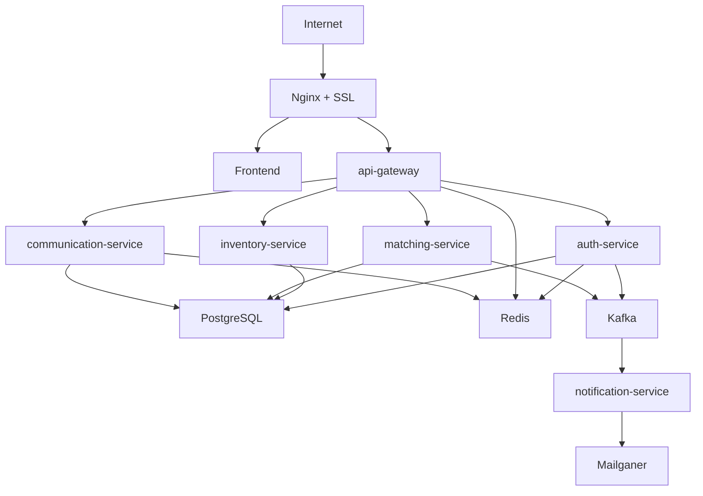

# Runtime Topology

## Production shape

## Notes

- `notification-service` is a background worker.
- `notification-service` has no own DB in MVP.
- WebSocket traffic terminates at gateway / communication edge.
- Postgres schemas are service-owned.
- Redis state is ephemeral.
- Kafka carries only notification events in MVP.
