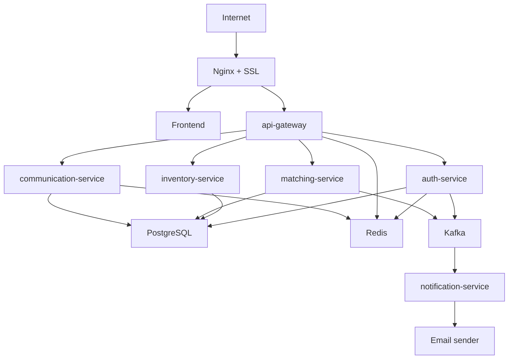
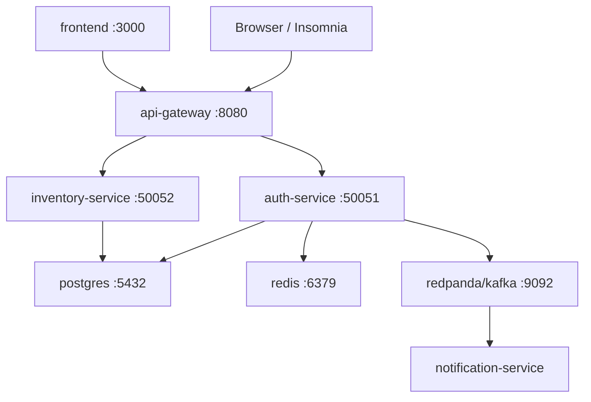

# Runtime Topology

## Production shape



## Notes

- `notification-service` is a background worker.
- `notification-service` has no own DB in MVP.
- WebSocket traffic terminates at gateway / communication edge.
- Browser cookies terminate at `api-gateway`; downstream services receive identity metadata, not cookies.
- Gateway allows credentialed CORS only for configured frontend origins.
- Postgres schemas are service-owned.
- Redis state is ephemeral.
- Kafka carries only notification events in MVP.
- Local development uses notification email stub logs; Mailganer is planned as production provider.

## Local Docker shape

Default local compose stack:



Kafka listeners:

- containers use `kafka:9092`
- host `go run` services use `localhost:19092`

Local API-only run:

```bash
docker compose --env-file .env up -d postgres redis kafka auth-service inventory-service notification-service api-gateway
```

Local frontend origin defaults to `http://localhost:3000`; gateway CORS must include that origin so browser cookies work across `localhost:3000` -> `localhost:8080`.

Full local run with frontend:

```bash
docker compose --env-file .env up --build
```
