# Sequence Diagrams

## 1. Register + send verification code

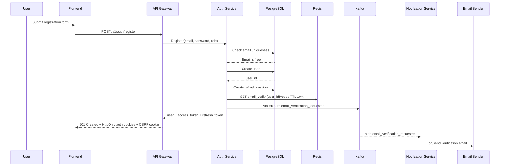

## 2. Resend verification code

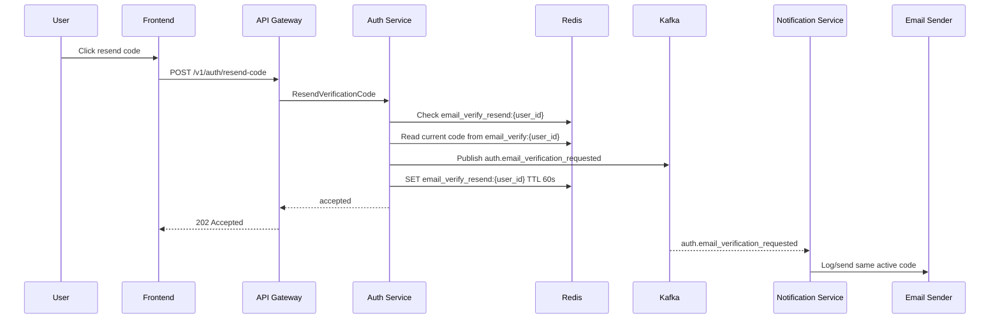

## 3. Verify email

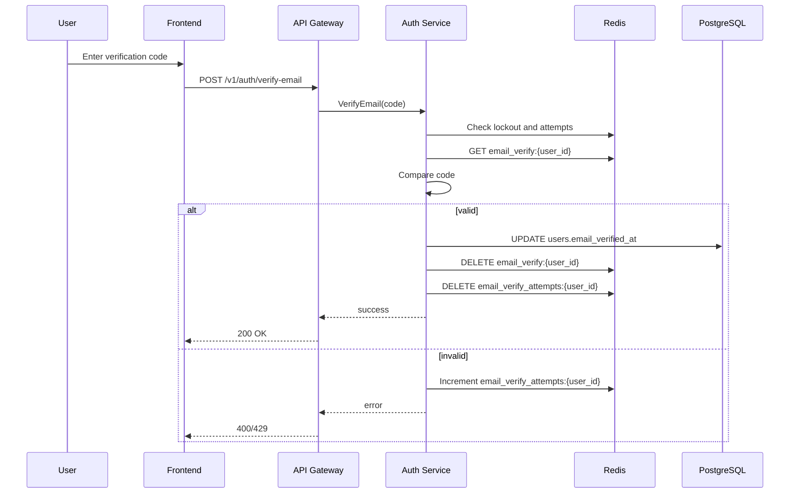

## 4. Login verified user

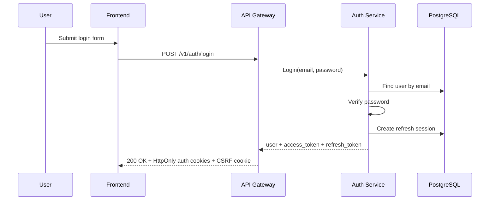

## 5. Create PVZ

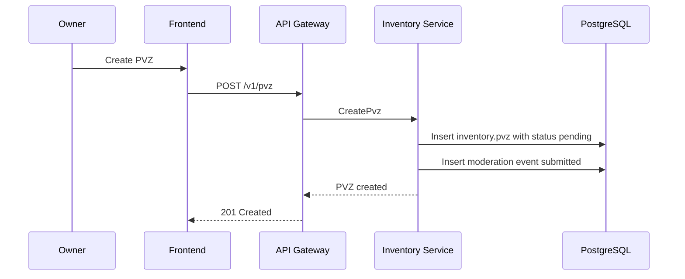

## 6. Approve / Reject PVZ

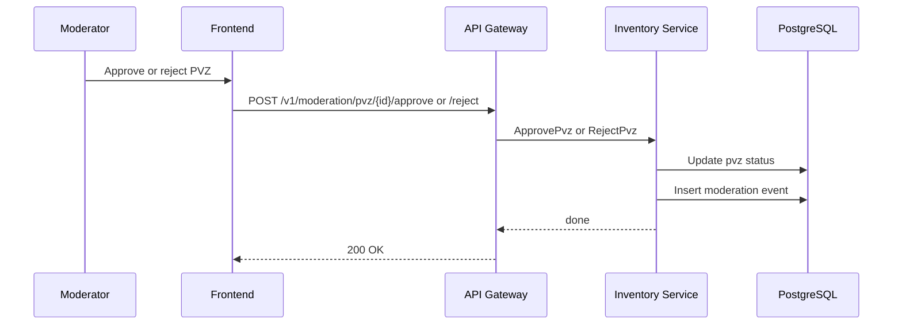

## 7. Update PVZ and move back to pending

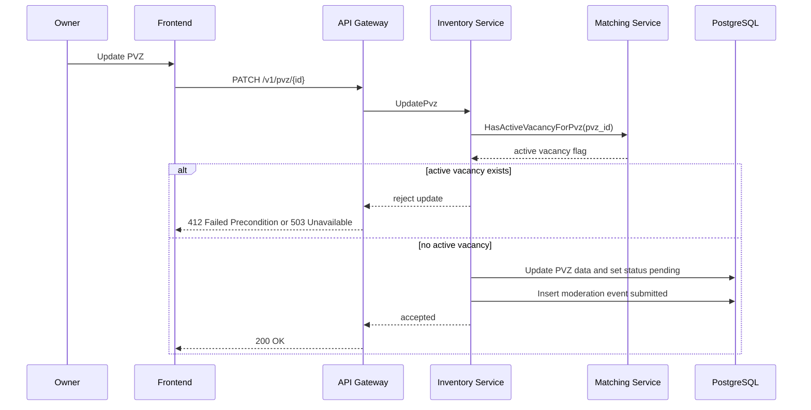

## 8. Create vacancy

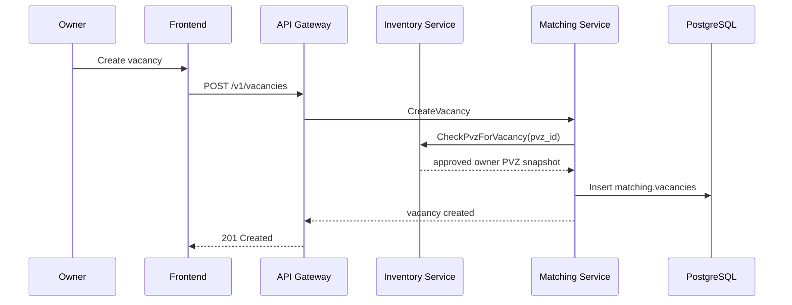

## 8a. Moderator spam cleanup for owner

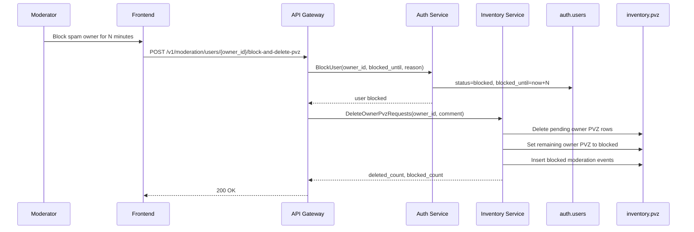

## 9. Create response + create conversation + notify owner

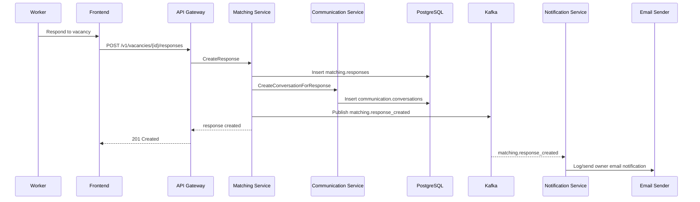

## 10. Send message

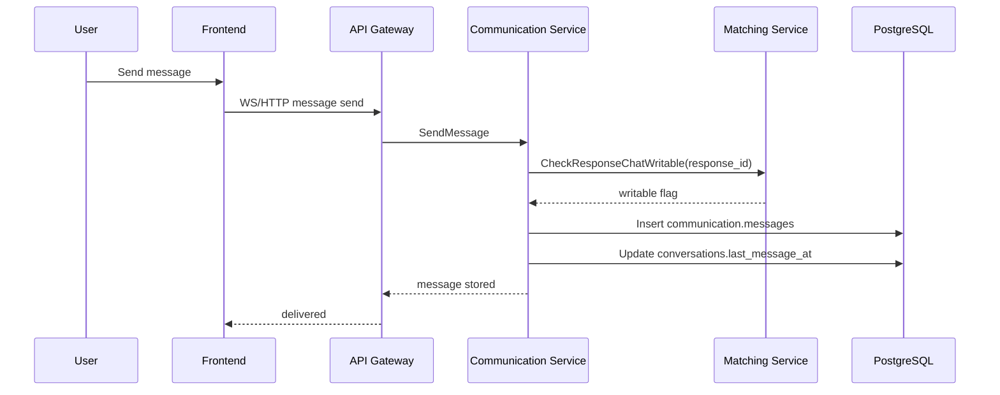

## 11. Accept response -> assignment

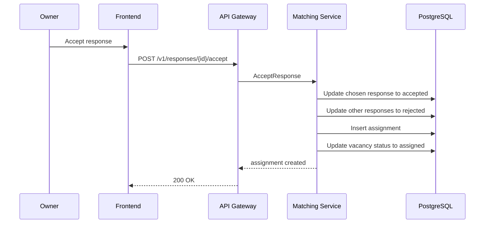

## 12. Cancel assignment

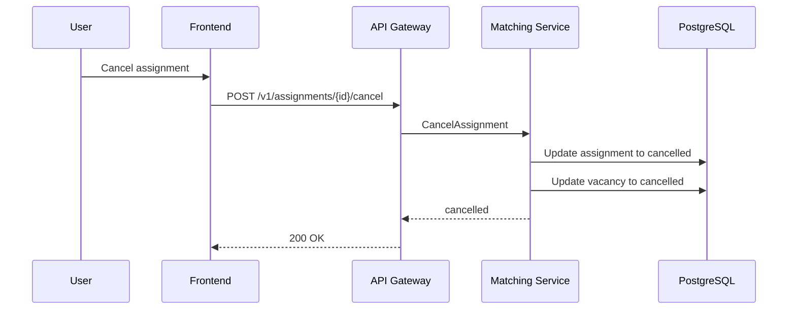

## 13. Complete assignment

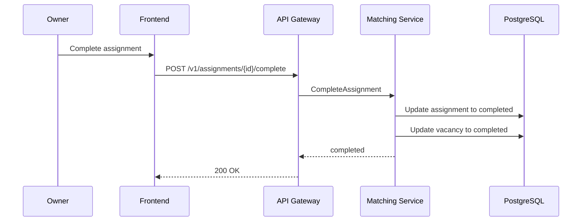

## 14. Create review

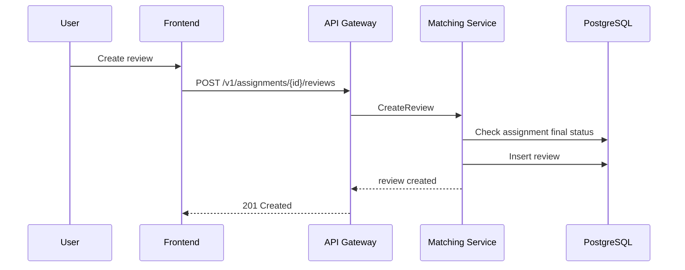

## 15. Create review reply

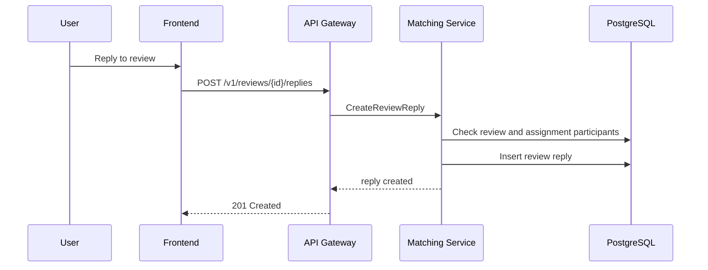
